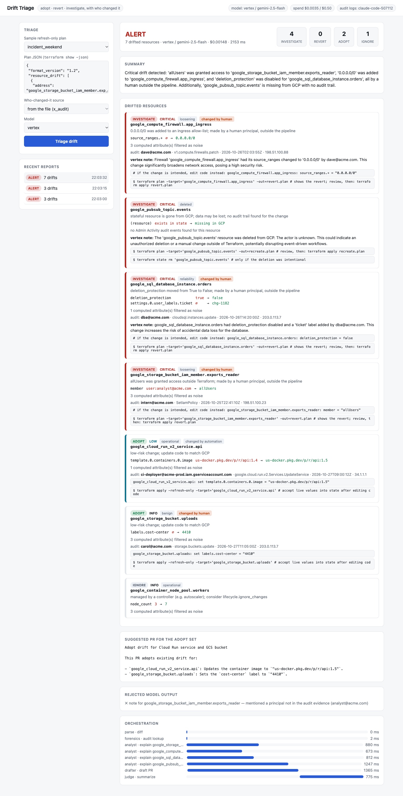

# gcp-drift-triage

`terraform plan -refresh-only` tells you that something changed outside Terraform. It does not tell you
**whether it matters, who did it, or what to do**. This tool does: for every drifted resource it decides
**adopt**, **revert**, **investigate** or **ignore**, attributes the change to a principal using Cloud Audit
Logs, and emits the exact commands and code edits.



## How it works

```
terraform plan -refresh-only  ->  show -json  ->  resource_drift
        |
   [parse]      diff state vs live (set semantics for lists), strip provider-computed noise
   [classify]   rules: loosening / tightening / cost / reliability / operational / benign / deleted
        |       -> category, severity, decision                          deterministic
   [forensics]  Cloud Audit Logs: who changed it, when, from which IP    parallel, best effort
   [attribute]  a human loosening access by hand is escalated one level  deterministic
   [commands]   revert: plan -target; adopt: code edit + refresh-only apply; deleted: recreate or state rm
        |
   parallel:    [analyst x5] explain the risky ones   -> validated against the plan and audit evidence
                [drafter]    PR text for the adopt set -> validated the same way
   [judge]      posture alert / attention / clean from rules; summary guarded
```

Rules own category, severity and decision. Models only write explanations; their text is rejected if it
mentions a principal not in the audit evidence, a resource not in the drift, or any link.

| Drift | Decision |
|---|---|
| `allUsers` / a new member added to IAM, `0.0.0.0/0` added, `deletion_protection` off | investigate (critical/high), revert command first |
| Stateful resource deleted in GCP | investigate (critical), recreate or `state rm` |
| Machine type / instance counts / disk size raised | investigate (medium) |
| Label added, safe flag restored, member removed | adopt, with the exact code edit |
| Image changed by a deploy | adopt (operational) |
| Autoscaler node count, etags, update times | ignore (suggests `lifecycle.ignore_changes`) |
| Attribute no rule covers | investigate, never silently adopted |

## Tested against real drift

I created a bucket, a Pub/Sub topic and an IAM binding with Terraform in a real project, then changed them by hand
with `gcloud`: disabled bucket versioning, added a label, granted a service account read access, deleted the topic.
`terraform plan -refresh-only` reported all three resources, and the tool classified them correctly, attributed
every change to the human who made it from **real Admin Activity audit logs**, and ran the same way on Cloud Run
(`audit: cloud`). The demo is reproducible from [demo/main.tf](demo/main.tf)
([runbook](docs/runbooks/05-real-drift-demo.md)). The real run exposed three bugs that synthetic tests missed
(reordered IAM member lists looked like new grants, the audit search used the Terraform name instead of the real
resource name, and label drift hides under `effective_labels`); all are fixed and covered by tests.

## Quick start (local)

```bash
python3 -m venv .venv && .venv/bin/pip install -e ".[dev]"
.venv/bin/driftriage triage driftriage/samples/incident_weekend.json --llm none; echo "exit=$?"   # 2 = alert

terraform plan -refresh-only -out=drift.plan && terraform show -json drift.plan > drift.json
.venv/bin/driftriage triage drift.json --audit-project my-project --llm vertex   # who changed it, via audit logs

DRIFTRIAGE_LLM=mock .venv/bin/uvicorn driftriage.api:app_factory --factory --port 8080   # web UI
```

Exit codes: 0 clean, 1 attention, 2 alert, 3 error. `--llm`: `none`, `mock`, `vertex`, `openai` (tests/evals only).

## Deploy to GCP

```bash
cp deploy.env.example deploy.env && ./scripts/up.sh      # foundation -> Cloud Build -> Cloud Run
gcloud run services proxy drift-triage --region us-central1 --port 8081
./scripts/down.sh
```

Terraform creates APIs, Artifact Registry, a build identity, a runtime service account (`aiplatform.user`,
`logging.logWriter`, **`logging.viewer`** to read audit logs) and a private Cloud Run service (0-2 instances,
invoker = one admin). Audit lookups are limited to the configured project. Reports are kept in memory only.

Docs: [architecture](docs/architecture.md) · [threat model](docs/threat-model.md) · [runbooks](docs/runbooks/) ·
[ADRs](docs/adr/) · [eval results](docs/eval-results.md)

## Verification

| Check | Result |
|---|---|
| Offline tests | 50 pass: parsing and set semantics, every rule, actor escalation, hostile-model cases, audit provider, API, CLI |
| Live tests (opt-in) | Vertex, OpenAI and a read-only audit-log query: pass |
| Cross-provider eval (18 runs) | **0 invariant violations**: decisions, severities and attribution identical to rules-only |
| Real drift end to end | 3 of 3 drifted resources detected and attributed from real audit logs, locally and on Cloud Run |
| Deployed | unauthenticated = 403; `openai` = 403; cloud audit only for the configured project |

Eval (6 runs per provider): gemini-2.5-flash and gpt-5-nano each had 12 notes kept and 2 rejected for naming a
principal that was not in the audit evidence; no PR text was rejected. Cost for 6 runs: gemini $0.005, gpt-5-nano $0.001.

## Limits

- Needs a refresh-only plan: it sees only what Terraform manages. Unmanaged resources are out of scope.
- Rules cover common GCP types and attributes; anything else is classified `unknown` and routed to investigate.
- Audit attribution finds the newest Admin Activity event whose resource name contains the real resource name, so
  a busy resource can be attributed to a later, unrelated change. Treat it as a strong lead, not proof. Data Access
  logs and logs older than the lookup window (7 days) are not searched.
- Scalar lists (members, source ranges) are compared as sets; an attribute where order matters would be missed.
- Model notes can still paraphrase (one invented a display name from an email address); they cannot change a decision.
- Verified on three synthetic plans and one small real drift; large estates are untested.
